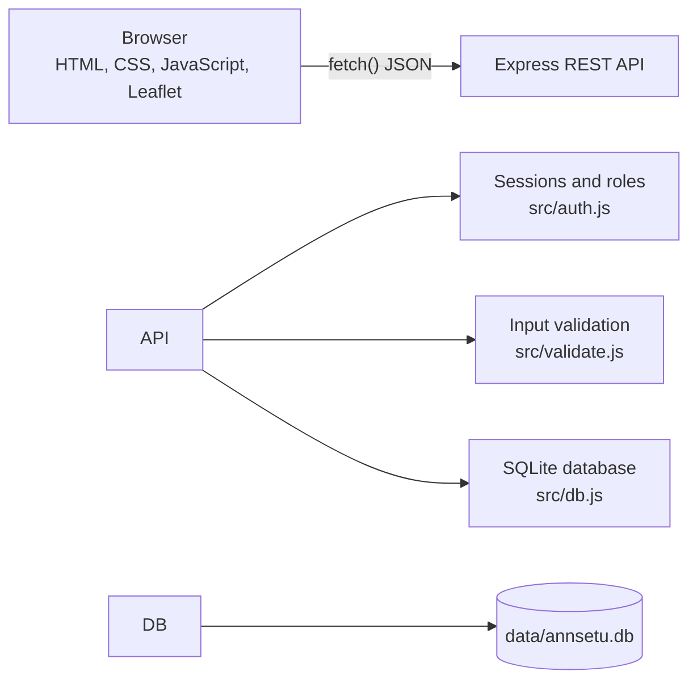
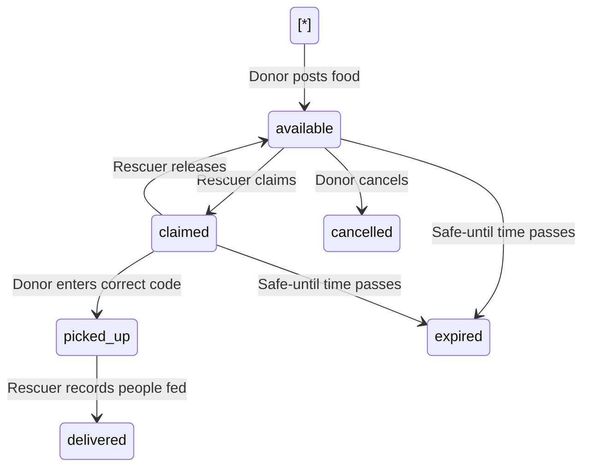

# AnnSetu: Food Rescue Network

**AnnSetu** (*ann* = food, *setu* = bridge) connects restaurants, hostel messes, caterers and canteens that have extra cooked food with NGOs and volunteers who can get it to people in need, before it spoils.

!\[AnnSetu home page](docs/home.png)

## The problem

Large amounts of cooked food are thrown away every day by restaurants, hostels and events, while shelters and community kitchens nearby struggle to feed people. The food is there and the need is there, but there is no quick way for the two to find each other within the few hours that cooked food stays safe.

## The solution

1. A **donor** posts extra food: what it is, veg or non-veg, how many people it can feed, and until when it is safe to eat.
2. **NGOs and volunteers** see food on a live map, sorted by distance or by how soon it expires, and claim it with an arrival time.
3. The rescuer gets a **4-digit pickup code**. The donor enters this code at handover, which proves the food went to the right person.
4. The rescuer records **how many people were fed**, and the public impact dashboard updates.

Food that is not collected in time is automatically marked as expired.

## Features

**For donors**

* Post food in under a minute with quick "safe for 2 / 4 / 6 hours" choices
* Pickup location on a map, pre-filled from the profile
* See who claimed the food, when they will arrive, and call them in one tap
* Confirm handover with the rescuer’s pickup code
* Donation history with outcomes (delivered, expired, cancelled)

**For NGOs and volunteers**

* Live map and list of food waiting nearby, with the distance to each pickup
* Filters for veg / non-veg and distance, sorting by nearest or expiring soonest
* Claim food with an arrival time and receive a pickup code
* Directions link, donor contact details, and "I can’t make it" to release a claim
* Record people fed after delivery

**For everyone**

* Live countdown bar on every listing that changes colour as food gets close to its safe-until time
* Public impact dashboard: meals rescued, people fed, food kept out of the bin, 14-day chart and top donors
* Indian veg and non-veg food symbols
* Works on phones, with keyboard and screen reader support

|Donor dashboard|Rescuer dashboard|
|-|-|
|!\[Donor dashboard](docs/donor-dashboard.png)|!\[Rescuer dashboard](docs/rescuer-dashboard.png)|

## Tech stack

|Layer|Technology|
|-|-|
|Frontend|HTML, CSS, vanilla JavaScript (no framework, no build step)|
|Maps|Leaflet with OpenStreetMap / CARTO map tiles|
|Backend|Node.js, Express.js|
|Database|SQLite (through sql.js, so nothing needs to be installed)|
|Authentication|Passwords hashed with scrypt, sessions in HTTP-only cookies|

## Getting started

You need [Node.js](https://nodejs.org) version 18 or newer.

```bash
git clone https://github.com/<sandali3110>/annsetu-food-rescue-network.git
cd annsetu-food-rescue-network
npm install
npm start
```

Open **http://localhost:3000**.

On the first run the app creates the database at `data/annsetu.db` and fills it with sample data for Pune.

### Demo accounts

All demo accounts use the password **`demo1234`**. The login page also has one-click demo buttons.

|Role|Email|Organisation|
|-|-|-|
|Donor|`donor@demo.com`|Hotel Saffron Kitchen|
|Donor|`banquet@demo.com`|Royal Banquet Hall|
|NGO|`ngo@demo.com`|Annapurna Seva Trust|
|Volunteer|`volunteer@demo.com`|Deccan Youth Volunteers|

### Before a demo

Sample listings are timed relative to when the database was created, so they expire after a few hours. Run this right before presenting to get fresh food on the board:

```bash
npm run reset-db
npm start
```

### Suggested demo (about 3 minutes)

1. Open the home page and point out the live countdown bars and the impact numbers.
2. In a normal window, log in as the **donor** and post new food.
3. In a private/incognito window, log in as the **NGO**, find that food on the map and claim it. Note the pickup code.
4. Back in the donor window, enter a wrong code (it is rejected), then the right one.
5. In the NGO window, open **My pickups** and mark the food as delivered.
6. Refresh the home page: the impact numbers have gone up.

## How it works



### Life of a listing



### Database

|Table|Main columns|
|-|-|
|`users`|id, name, email, password\_hash, role (`donor` or `rescuer`), org\_name, phone, address, lat, lng|
|`sessions`|token, user\_id, expires\_at|
|`listings`|id, donor\_id, title, food\_type, servings, safe\_until, pickup\_address, lat, lng, status, claimed\_by, pickup\_eta, pickup\_code, picked\_up\_at, delivered\_at, people\_served|

### Design decisions worth knowing for a viva

* **No double claims.** The claim query is `UPDATE ... WHERE id = ? AND status = 'available'`, so if two rescuers press "Claim" at the same moment only one update succeeds.
* **Privacy.** Phone numbers are only sent to the two people involved in a pickup, and the pickup code is only sent to the rescuer.
* **Secure passwords.** Passwords are hashed with scrypt and a random salt and compared with a timing-safe check. Session tokens live in HTTP-only cookies that JavaScript cannot read.
* **Validation on the server.** Every input is checked in `src/validate.js`, so the API stays safe even if someone bypasses the web page.
* **Distance.** Distance between a rescuer and each pickup point is calculated with the haversine formula in `src/geo.js`.

## API reference

Base URL: `http://localhost:3000/api`

|Method|Endpoint|Who|Description|
|-|-|-|-|
|POST|`/auth/register`|Anyone|Create an account and log in|
|POST|`/auth/login`|Anyone|Log in|
|POST|`/auth/logout`|Logged in|Log out|
|GET|`/auth/me`|Anyone|Current user, or `null`|
|GET|`/listings/available`|Anyone|Food waiting for pickup. Query: `foodType`, `maxKm`, `sort=distance`|
|GET|`/listings/mine`|Logged in|Donor: food I posted. Rescuer: food I claimed|
|POST|`/listings`|Donor|Post food|
|POST|`/listings/:id/cancel`|Donor|Cancel unclaimed food|
|POST|`/listings/:id/claim`|Rescuer|Claim food. Body: `{ "pickupEta": "<ISO date>" }`|
|POST|`/listings/:id/release`|Rescuer|Give up a claim|
|POST|`/listings/:id/pickup`|Donor|Confirm handover. Body: `{ "code": "4821" }`|
|POST|`/listings/:id/deliver`|Rescuer|Mark delivered. Body: `{ "peopleServed": 40 }`|
|GET|`/stats`|Anyone|Impact numbers, 14-day chart data, top donors|
|GET|`/config`|Anyone|Default city and map centre|

Errors return a JSON body such as `{ "error": "...", "fields": { "servings": "..." } }` with status 401 (not logged in), 403 (wrong role), 404, 409 (already claimed or expired) or 422 (invalid input).

## Project structure

```
annsetu-food-rescue-network/
├── server.js                 Starts Express, serves pages and the API
├── src/
│   ├── config.js             Port, city, impact assumptions
│   ├── db.js                 SQLite schema and query helpers
│   ├── auth.js               Password hashing, sessions, role checks
│   ├── validate.js           Input validation
│   ├── geo.js                Distance calculation
│   ├── seed.js               Sample data for demos
│   └── routes/
│       ├── auth.js           Register, log in, log out
│       ├── listings.js       Post, claim, pickup, deliver
│       └── stats.js          Public impact numbers
├── public/
│   ├── index.html            Home page with live board, impact and map
│   ├── auth.html             Log in and create account
│   ├── donor.html            Donor dashboard
│   ├── rescue.html           NGO and volunteer dashboard
│   ├── css/style.css
│   └── js/                   One script per page plus shared helpers
├── scripts/reset-db.js       Deletes the database for a fresh start
├── data/                     Database file is created here
└── docs/                     Screenshots
```

## Configuration

Edit `src/config.js` to change the city and map centre, the port, or the kilograms-per-meal estimate used on the impact dashboard. The port can also be set with the `PORT` environment variable.

The map tiles and the Archivo font load from the internet. Without a connection the app still works, but maps show no streets and a system font is used.

## Future scope

* SMS or WhatsApp alerts to nearby NGOs when food is posted
* Photo of the food with each listing
* Admin panel to verify NGOs before they can claim food
* Ratings and feedback after each pickup
* Route planning for volunteers collecting from several donors
* Progressive Web App so it can be installed on phones

## License

MIT. See [LICENSE](LICENSE).

